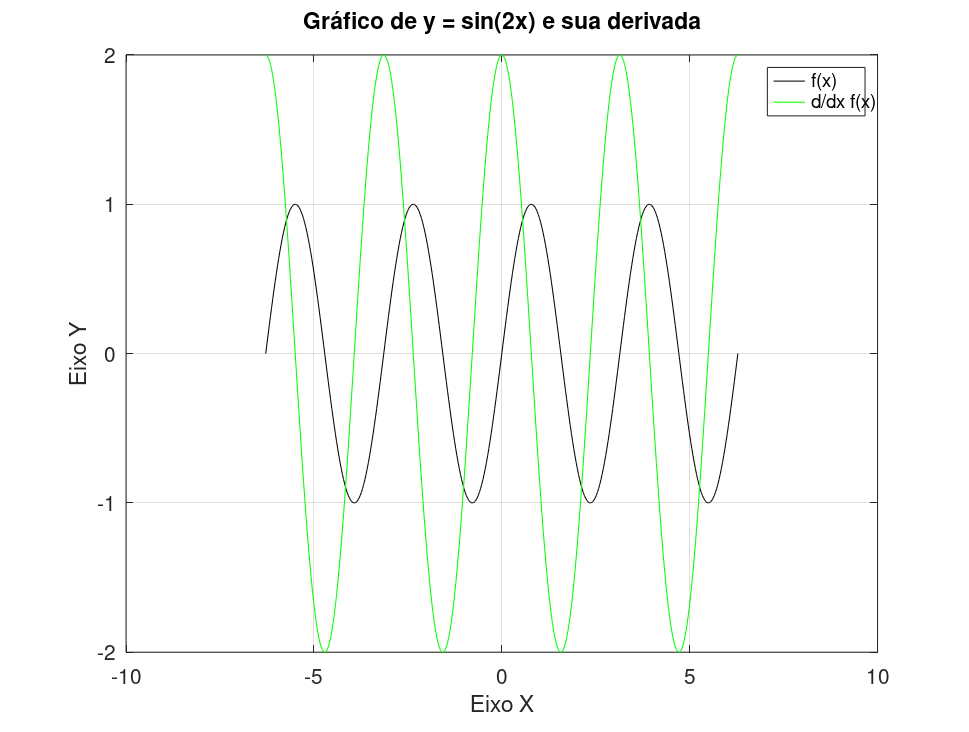
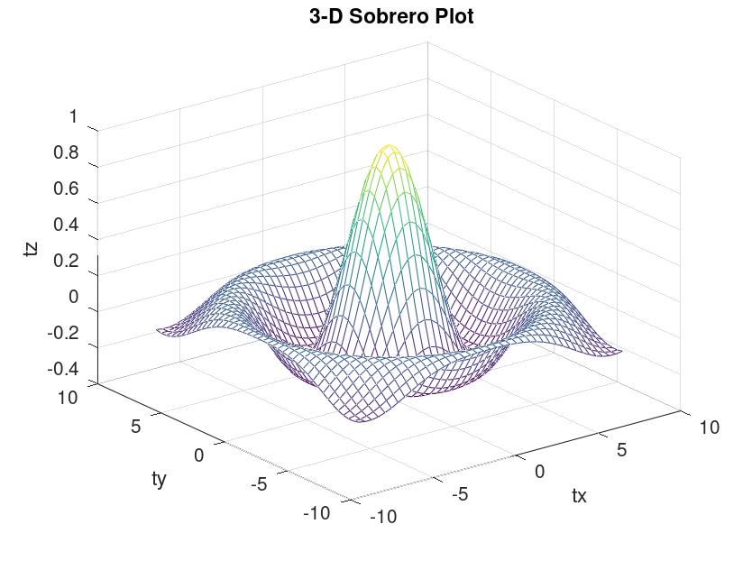
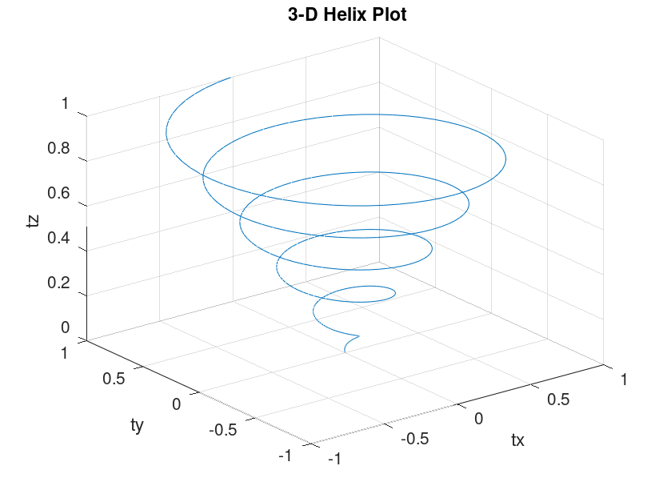
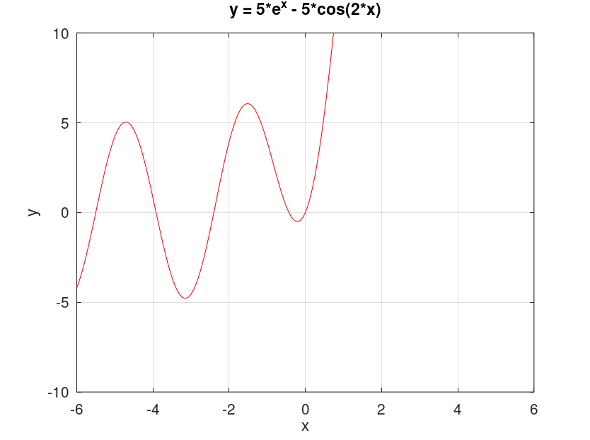

# Cálculo Numérico

Material de apoio à disciplina de Cálculo Numérico (UFCG), com exemplos didáticos escritos em GNU Octave. O repositório reúne visualizações de funções e implementações introdutórias de métodos iterativos para encontrar raízes de equações não lineares.

## Conteúdo

| Pasta | Conteúdo |
| --- | --- |
| [`1-funcoes-2d`](1-funcoes-2d/) | Gráfico de uma função e de sua derivada. |
| [`2-funcoes-3d`](2-funcoes-3d/) | Superfície 3D e curva helicoidal. |
| [`3-solucoes-raiz`](3-solucoes-raiz/) | [Bissecção](3-solucoes-raiz/metodo_bisseccao.m), [falsa posição](3-solucoes-raiz/metodo_falsa_posicao.m), [falsa posição modificada](3-solucoes-raiz/metodo_falsa_posicao_modificado.m), [Newton](3-solucoes-raiz/metodo_newton.m) e [secante](3-solucoes-raiz/metodo_secante.m). |
| [`exercicios`](exercicios/) | Scripts e funções usados em exercícios da disciplina. |

## Requisitos

- [GNU Octave](https://octave.org/)
- Git, para clonar o repositório

Os scripts são exemplos de estudo e alguns pedem valores pelo terminal durante a execução.

## Como executar

Clone o repositório e entre na pasta:

```sh
git clone https://github.com/Alyssonmach/calculo-numerico.git
cd calculo-numerico
```

Execute cada script a partir da pasta que contém os arquivos de função usados por ele. Por exemplo, para rodar o método da bissecção:

```sh
cd 3-solucoes-raiz
octave metodo_bisseccao.m
```

O Octave solicitará a tolerância e os limites do intervalo. Para executar um dos gráficos, partindo da raiz do repositório, entre na pasta correspondente:

```sh
cd 1-funcoes-2d
octave func_plot.m
```

## Prévia dos gráficos

### Funções em 2D



### Funções em 3D

| Superfície | Hélice |
| --- | --- |
|  |  |

### Exercícios



## Contribuições

Sugestões, correções e novos exemplos são bem-vindos. Abra uma *issue* para discutir uma ideia ou envie um *pull request* com a descrição do método, os arquivos necessários e instruções para executá-lo.
